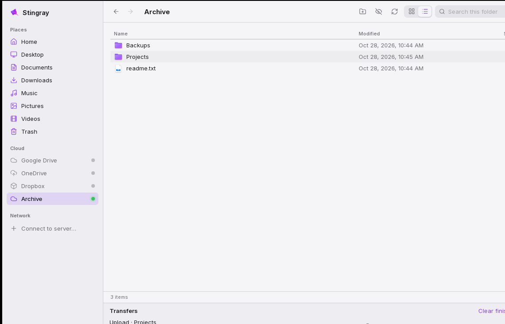

<p align="center"></p>

<h1 align="center">Stingray File Manager</h1>

<p align="center">A clean, modern file manager for Linux and Windows that puts your folders, your cloud drives and your servers in one window.</p>

<p align="center"></p>

## What it does

- **Your folders, where you expect them.** Home, Desktop, Documents, Downloads, Music, Pictures, Videos and Trash in the sidebar, plus USB sticks and second disks as you plug them in.
- **Cloud drives built in.** Google Drive, OneDrive and Dropbox each have a place in the sidebar. Click one to set it up: a short wizard opens your browser to sign in, and Stingray never sees your password.
- **Connection lights.** Each drive shows its state at a glance:
  - 🟢 green: connected
  - 🔴 red: set up, but not reachable right now (offline, or the sign-in expired)
  - ⚪ grey: not set up yet
- **Network drives.** *Connect to server…* adds SMB (Windows shares, Samba, most NAS boxes), SFTP (servers over SSH) and NFS.
- **Drag and drop anywhere.** Drag files between any two places: a local folder to Google Drive, OneDrive to a NAS, Dropbox to Downloads. On the same drive a drag moves; across drives it copies. Hold **Ctrl** (or **Alt**) to copy instead. Files dragged in from other apps are copied into the folder on screen.
- **Everything else you'd expect:** copy, cut and paste, rename in place, new folder, move to Trash, search this folder, icon and list views, picture thumbnails, hidden files on demand, and a transfer panel with progress and cancel.

It's a desktop app and works offline. It only goes online to reach your cloud drives.

## Keyboard

| Keys | Action |
|---|---|
| Enter | Open |
| Backspace, Alt+Up | Up one folder |
| Alt+Left / Alt+Right | Back / Forward |
| F2 | Rename |
| Delete | Move to Trash (asks first on cloud and network drives) |
| Ctrl+C / Ctrl+X / Ctrl+V | Copy / Cut / Paste |
| Ctrl+Shift+N | New folder |
| Ctrl+A | Select all |
| Ctrl+H | Show or hide hidden files |
| Ctrl+F | Search this folder |
| F5 | Refresh |

## Install

Download the latest release from the [Releases page](https://github.com/quietbytehq/stingray/releases):

- **Linux:** `.AppImage` (any distribution) or `.deb` (Debian, Ubuntu, Mint, Pop!_OS)
- **Windows:** `.msi`

### NFS notes

rclone has no NFS client, so Stingray asks the operating system to connect NFS shares:

- **Linux:** needs `nfs-common` (Debian, Ubuntu) or `nfs-utils` (Fedora, Arch). Your desktop asks for your password when a share connects; it appears under `~/NFS/<name>`.
- **Windows:** needs *Client for NFS*, which is part of Windows Pro and Enterprise. Turn it on under *Windows Features*.

## How it works

Stingray is built with [Tauri 2](https://tauri.app): a Rust backend and a Svelte interface, drawn by the system's own web engine (WebKitGTK on Linux, WebView2 on Windows). The installer is small and nothing runs in a browser.

Cloud, SMB and SFTP drives go through [rclone](https://rclone.org), which ships inside Stingray and runs in the background on a private local port. Sign-ins are stored only in rclone's own config file in Stingray's data folder. The storage engine comes from its sibling project, [Orbit for rclone](https://github.com/quietbytehq/orbit).

## Build from source

You need Node.js 22, Rust (stable), and on Linux the Tauri system packages:

```sh
sudo apt install libwebkit2gtk-4.1-dev libayatana-appindicator3-dev librsvg2-dev libssl-dev
```

Then:

```sh
npm install
npm run fetch:rclone          # downloads the pinned rclone into src-tauri/binaries
npm run tauri dev             # run it
npm run bundle:linux          # AppImage and .deb
npm run bundle:windows        # .msi (on Windows)
```

Tests: `npm run check`, `npm test`, and `cargo test --manifest-path src-tauri/Cargo.toml`.

The app icons are generated from `assets/logo/source.jpeg` by `python3 assets/logo/gen.py`.

## License

Apache License 2.0. See [LICENSE](LICENSE) and [NOTICE](NOTICE).

Made by [QuietByte](https://github.com/quietbytehq).
